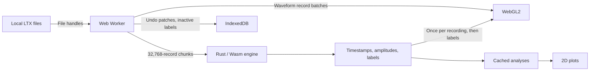

# Architecture

## Ownership

React owns UI state and display arrays, never the waveform file. A module worker owns the Rust engines (one Wasm instance), file references, cut sessions and analysis caches; requests are serialised there, so labels and history cannot be edited concurrently. The worker request protocol is typed in `src/worker/protocol.ts`, and the Wasm exports in `src/worker/wasm.ts` (a unit test checks the table against the compiled module).

The Rust crate (`core/`) is dependency-free. It parses tetrodes and cut/CLu files incrementally, computes peak-to-peak amplitudes, applies every edit (lasso, brush, waveform gate, merge, swap, renumber), produces undo patches and exports, processes position, computes analyses, and selects and groups the GPU-resident waveform records. JavaScript does browser I/O, scheduling and buffer transfers.

## Source layout

- `core/src/`: the Rust engine, including the simulated recordings.
- `src/worker/`: the Web Worker and its modules (position parsing, IndexedDB undo history, simulated files, Wasm bindings), the main-thread `client.ts` and the shared `protocol.ts`.
- `src/app/`: hooks used by `App` (analyses, floating copies, waveform split, keyboard shortcuts, browser history, prepared cut downloads).
- `src/shell/`: layout regions (toolbar, files, position and feature panes, start screen), pane dividers, floating windows and tool panels.
- `src/tiles/`: the cell tile wall, its gestures (drag-merge, split, swap) and the GPU waveform renderer.
- `src/plots/`: the feature view and its GPU renderer, analysis and path plots, WebGL helpers and plot geometry.
- `src/`: `main.tsx`, `App.tsx` (application state, loading and edits), preferences, types, palette and file organisation.

## Population data

For N spikes (about 1.94 GB of file at 9M spikes, which is never copied whole into JS or Wasm; it is read through Blob slices):

| Data                  | Representation                                      | At 9M spikes    |
| --------------------- | --------------------------------------------------- | --------------- |
| Timestamps            | `u32[N]`, raw acquisition ticks                     | 36 MB           |
| Amplitudes            | `u8[N*4]`, peak-to-peak per channel                 | 36 MB           |
| Labels                | `u16[N]`                                            | 18 MB           |
| Cell membership index | lazy `u32` indices grouped by label                 | 36 MB once used |
| Waveform slot order   | `u32` per GPU-resident record (at most 1M), by cell | 4 MB            |

A waveform threshold needs one channel/sample column; the first gate on a column reads the file once and caches one byte per spike (two columns per tetrode). An interactive split also caches the source cell's waveforms (up to 400,000 spikes) so further adjustments need no file reads. The preview never touches history; finishing commits one undo patch and Escape restores the labels.

## GPU rendering

**Feature view.** Every spike is drawn from the population arrays (10 bytes per spike). Amplitudes and timestamps are sent once per recording and reattached by `worker/client.ts`; edits transfer only labels, which update one buffer in place. Axes, time range, point size and isolation are uniforms. Drift adds (1, normalised time) per spike into an `RG32F` target and colours each pixel by mean spike time, red (start) to green (end).

**Waveforms.** Up to 1M records are resident: all spikes up to 1M, otherwise 1M evenly spaced ones (flagged once in the toolbar). Records keep the file's 216-byte layout in an `R8I` texture array that the shader reads directly; the tile wall loads them in ~4 MB layers. Each cell renders once, in per-frame budgets, into a texture of per-pixel (line count, summed spike time), cached by a hash of the cell's resident records; frames only composite those textures into tiles. Flag, density and drift colour the same counts, so switching is instant, and edits re-render only cells whose membership changed.

Drift and exact counts need `EXT_color_buffer_float` and `EXT_float_blend`; without them drift is not drawn and density counts saturate. Nothing else is sampled: analyses, autocorrelograms and the position overlays use every spike.

Waveform frame geometry (shared by the shader, split marker and gestures) lives in `plots/plot-geometry.ts`.

## Caches

- **Recordings:** about 384 MiB of retained engine data; inactive tetrodes are evicted first.
- **Positions:** four processed variants (file × LED/jump/smoothing settings), each caching its trajectory and occupancy maps, which every cell's analysis reuses.
- **Analyses:** keyed by the cell's membership (spike count plus a 64-bit hash of its spike indices) and the analysis settings, in the worker (200) and the tile wall (512). Edits recompute only cells whose spikes changed; renumbered cells keep theirs. The worker reports the membership it analysed so a result can't be filed under a stale key.
- **GPU:** four feature-view buffer sets; waveform tile textures up to 192 MB.

## Cut histories

Each (file, cut) has its own undo/redo history. The first edit of an imported cut, or of an unsorted recording, creates a separate local (blue) cut; files on disk are never modified. Each edit stores an immutable patch in IndexedDB (sparse changed indices, or dense labels when smaller) before it is accepted; undo/redo applies a patch without re-reading spikes. Switching cuts saves the outgoing labels to IndexedDB. History lives for the browser tab; exporting a `.cut` is the durable result.

Only explicit trial/tetrode/cut choices add browser history entries, so Back/Forward moves between recordings (cancelling an open split first).

## Simulated recordings

The start screen's demo generates five trials of eight tetrodes (about 50k spikes over 20 minutes each) in Rust, on demand by record range, so no large fake files are held. Cells are place, head-direction or untuned, with Poisson spiking and theta modulation; one or two cells per tetrode drift in amplitude. Tetrode 7 is partly cut and tetrode 8 has no cut. `?demo=quick` is a smaller fixed-seed version for tests; `?demo=stress` generates 9M spikes and 100 cells.

## Static hosting

Vite emits relative paths and a hashed Wasm asset, so the app runs from GitHub Pages under `/waveform/` with no server, SharedArrayBuffer or cross-origin isolation headers.
