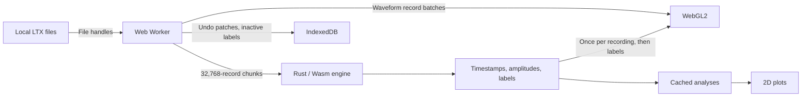

# Architecture

## Ownership

React owns UI state and display arrays, never the waveform file. A module worker owns the Rust engines (one Wasm instance), file references, cut sessions and analysis caches; requests are serialised there, so labels and history cannot be edited concurrently. The worker request protocol is typed in `src/worker/protocol.ts`, and the Wasm exports in `src/worker/wasm.ts` (a unit test checks the table against the compiled module).

The Rust crate (`core/`) parses tetrodes and cut/CLu files incrementally, computes peak-to-peak amplitudes, applies every edit (lasso, brush, waveform gate, merge, swap), produces undo patches and exports, processes position, computes analyses, and selects and groups the GPU-resident waveform records. RustFFT provides FFTs through the reusable `dsp` module, including WebAssembly SIMD acceleration. Nalgebra provides covariance multiplication and symmetric eigendecomposition for waveform PCA, using the same dependency version/features as prekk. JavaScript does browser I/O, scheduling and buffer transfers.

## Source layout

- `core/src/`: the Rust engine, including the simulated recordings.
- `src/worker/`: the Web Worker and its modules (position parsing, IndexedDB undo history, simulated files, Wasm bindings), the main-thread `client.ts` and the shared `protocol.ts`.
- `src/app/`: hooks used by `App` (analyses, floating copies, waveform split, keyboard shortcuts, browser history, prepared cut downloads).
- `src/shell/`: layout regions (toolbar, files, position and feature panes, start screen), pane dividers, floating windows and tool panels.
- `src/tiles/`: the cell tile wall, its gestures (drag-merge, split, swap) and the GPU waveform renderer.
- `src/plots/`: the feature view and its GPU renderer, analysis and path plots, WebGL helpers and plot geometry.
- `src/`: `main.tsx`, `App.tsx` (application state, loading and edits), preferences, types, palette and file organisation.

## Population data

For N spikes (about 1.94 GB of file at 9M spikes, which is never copied whole into JS or Wasm; it is read through Blob slices):

| Data                  | Representation                                      | At 9M spikes    |
| --------------------- | --------------------------------------------------- | --------------- |
| Timestamps            | `u32[N]`, raw acquisition ticks                     | 36 MB           |
| Amplitudes            | `u8[N*4]`, peak-to-peak per channel                 | 36 MB           |
| Labels                | `u16[N]`                                            | 18 MB           |
| Cell membership index | lazy `u32` indices grouped by label                 | 36 MB once used |
| Waveform slot order   | `u32` per GPU-resident record (at most 1M), by cell | 4 MB            |

A waveform threshold needs one channel/sample column; the first gate on a column reads the file once and caches one byte per spike (two columns per tetrode). An interactive split also caches the source cell's waveforms (up to 400,000 spikes) so further adjustments need no file reads. The preview never touches history; finishing commits one undo patch and Escape restores the labels.

## GPU rendering

**Feature view.** Every spike is drawn from the population arrays (10 bytes per spike). Amplitudes and timestamps are sent once per recording and reattached by `worker/client.ts`; edits transfer only labels, which update one buffer in place. Axes, time range and pixel ratio are uniforms; cluster points stay at one CSS pixel. Selecting a cell brings its points forward in fixed colours; it does not hide other cells. Density and drift accumulate (count, summed time) per pixel, with the same texture formats and fallbacks as waveform rendering. Density shares the waveform colour ramp through `plots/density-colours.ts`, with scaling appropriate to point footprints; drift uses mean spike time, red (start) to green (end). Cached counts survive colour-mode switches, label edits and cell focus changes; coordinates, geometry or time range changes invalidate them.

The cluster pane can instead use four global waveform PCs, fitted across all 200 signed sample values (four channels × 50 samples, excluding timestamps). `core/src/pca.rs` plans reproducible, jittered sample blocks across the recording, fits a centred covariance using nalgebra, then projects the complete file in bounded chunks. Constant input dimensions are excluded; PCs are ordered by descending variance with deterministic signs, and scores are scaled to 0–1 over the full population. Degenerate axes stay at 0.5. The default fit uses up to 5,000 spikes, configurable from 500 to 20,000. No full waveform population is retained.

PCA adds four float32 coordinates (16 bytes per spike) only when requested. `worker/pca.ts` handles its file reads and cancellation. The basis depends on the recording and fit sample size, so cuts and undo do not refit it; the UI caches one result and confirms the worker's basis before reuse. GPU buffers accept byte amplitudes or float PCs, and both CPU picking and Rust brush/lasso cuts use exactly the displayed coordinates. Region edits carry the PCA basis key to reject stale selections after a refit. Both spaces show the same six channel/component pairings.

**Waveforms.** Up to 1M records are resident: all spikes up to 1M, otherwise 1M evenly spaced ones (flagged once in the toolbar). Records keep the file's 216-byte layout in an `R8I` texture array that the shader reads directly; the tile wall loads them in ~4 MB layers. Each cell renders once, in per-frame budgets, into a texture of per-pixel (line count, summed spike time), cached by a hash of the cell's resident records; frames only composite those textures into tiles. Flag, density and drift colour the same counts, so switching is instant, and edits re-render only cells whose membership changed.

Waveform density matches v1's tetrode-wide scale: its original colour ramp receives `sqrt(10 × pixel count / total resident waveforms)`, using one denominator for every cell, including captures. Dividing by the resident total preserves the population fraction for sampled recordings; filtering or scrolling the wall does not rescale the palette. Fixed colours and drift do not use this normalisation.

Drift and exact counts need `EXT_color_buffer_float` and `EXT_float_blend`; without them drift is not drawn and density counts saturate. Nothing else is sampled: analyses, autocorrelograms and the position overlays use every spike.

Waveform frame geometry (shared by the shader, split marker and gestures) lives in `plots/plot-geometry.ts`.

Plot buttons, rendering options and feature-pane choices share `shell/ToggleButton.tsx`: small-radius corners, neutral pressed fill, stronger border/icon, and `aria-pressed`. Mutually exclusive choices (colour mode, tetrode, feature space and brush/lasso) use joined segments; independent plot toggles retain gaps. Trials use square stacked rows with the same neutral selected fill and horizontal rules. In copy mode, excluded trials are faded and desaturated; included trials retain normal file colours and selected-cut styling. The displayed trial keeps a stronger background. The feature-tool pairs are separated from each other and from the source/destination controls, with matching row centres even when sources wrap. The feature-space icons have full accessible names and tooltips (Amplitudes / Principal components).

`Settings.renderMode` is one of fixed/density/drift, shared by waveform and feature plots; saved independent drift/density booleans migrate to this single choice. The independent palette button at the left of the cluster toolbar persists a fixed-colour override for those plots; turning it off resumes following the main mode. P cycles forwards and Shift+P backwards; D has no binding. Q switches amplitudes/principal components; L switches brush/lasso. App text selection is disabled except for editable fields and header content; selected header text retains native Cmd/Ctrl-C rather than invoking plot copying.

The Settings pane starts with position processing: Use both LEDs when available is checked by default and falls back to one LED and movement direction when a second LED is unavailable. The Cluster plots section contains the PCA fit sample size, followed by separate sections for spatial rate maps, spatial autocorrelation, direction, speed and temporal autocorrelation. Settings sliders show a separate value readout with units and labelled endpoints. Zero is shown as Off for boxcar smoothing, jump filtering and position smoothing, or Auto for the rate-map colour maximum; short hints explain those states, which are also exposed as accessible slider values. Reset settings is at the top of the pane.

Position samples use a regular clock starting at zero, defined by the header's sample rate; embedded record timestamps do not affect processing. Spike lookup is a direct sample-index calculation, each valid sample contributes one sample period of dwell, and speed/jump filtering use elapsed sample counts. LED swapping uses v1-style pixel-size evidence plus a continuity improvement exceeding 1 cm for each LED, comparing against the preceding corrected positions. Raw pixel-count statistics are cached once and shared by processing variants; missing or indistinguishable spot sizes cannot trigger a swap. Combining two valid LEDs retains their midpoint. Spatial maps retain v2's binning and position-smoothing settings, while masking bins that were unvisited before rate-map smoothing. Directional plots use v1's display convention: zero points left and pi/2 points up.

`shell/FileMenu.tsx` holds the Waveform icon's keyboard-accessible dropdown, with Add folder…, Add files… and Clear files. Both pickers add to the workspace through `FileInputs.tsx`; Clear files returns directly to the start screen without a confirmation dialog. Closed menus leave app shortcuts available.

## Clipboard comparisons

Copy mode can include additional trials without changing the displayed recording. Each uses the same tetrode number and its remembered cut (or first cut), including saved local edits; clicking its existing cut buttons can override that choice for the clipboard. The worker's `copy_analysis` request streams one secondary population at a time through the shared recording reader, computes summaries with the existing Rust analysis engine, and frees the temporary engine in `finally`. It never activates that recording, builds its waveform order, or transfers its population to the UI. New selections cancel obsolete reads between chunks; completed summaries are reused within copy mode.

`app/copy-plots.ts` draws analysis captures at consistent sizes. `app/clipboard-layout.ts` builds a borderless HTML table for multiple trials, with fixed column widths and one subrow per chart type. Headings use `t# c#` (tetrode first). Headings and statistics remain editable text; plots remain separate images, with a subtle cross for missing cells, tetrodes or position data. Multi-trial copies omit spike counts and put peak firing rates above the spatial and directional maps, with a footnote explaining the values. The left column contains the cell heading and optional waveforms, narrowing to the heading when waveforms are hidden. Empty waveform cells preserve alignment without spacer images or font-dependent whitespace. Shared trial-name prefixes are omitted from column headers; footnotes identify the waveform source and record the full trial names and selected cuts. Only the displayed trial contributes waveforms. A single trial uses the original title-and-stats line followed by its plots in one compact row, without a table or trial footnotes.

Cmd/Ctrl-C targets the position pane when hovered; holding it for 500 ms enters path copy mode. Tile clicks select spike overlays, with other tiles faded. Live paths and copies share centred, pixel-aligned 3×3 CSS-pixel spike squares through `drawSpikeLayers`. `app/copy-paths.ts` exports a 160 px path and speed dwell per trial, each under an editable heading, with one shared coloured cell legend at the bottom. It reuses the live engine for the displayed recording and the same bounded temporary-engine path for other trials. This mode never captures tile plots.

Spatial autocorrelation (SC, off by default) follows the spatial rate map in the toolbar and tiles. A shows SC alone; Shift-A toggles it alongside other plots. `core/src/spatial_ac.rs` computes local Pearson correlations at every linear displacement from three forward and four inverse transforms through `dsp::Fft2`/RustFFT. Nonfinite bins are masked pairwise; overlaps below the configurable minimum (20 bins by default), and zero-variance overlaps, remain invalid. SC uses MATLAB jet(64) on a fixed −1 to +1 scale. It is calculated only when requested.

Simulated T5–8 have 2–5 grid cells mixed with place/directional/untuned cells; their place cells have broader fields (sigma 16–28 cm) and background activity of 20–40% of the field amplitude. T7 still has two sorted cells and T8 remains uncut. Grid membership, module exponents and cell phases are stable across trials. All modules share each trial's orientation and base spacing (about 36 cm), with spacing multiplied by 1.4 per tetrode from T5 onward; trials vary orientation and base spacing slightly.

## Caches

- **Recordings:** about 384 MiB of retained engine data; inactive tetrodes are evicted first.
- **Positions:** four processed variants (file × LED/jump/smoothing settings), each caching its trajectory and occupancy maps, which every cell's analysis reuses. Raw spatial, directional and speed dwell histograms share one bin-configuration cache per variant; smoothing the binned occupancy is still done per analysis. The UI requests trajectories by position identity/settings and retains the speed dwell array by those inputs plus speed binning, independently of cell, tetrode and cut. Both canvases stay mounted while cell analysis reloads, preserving the path's base image and avoiding speed histogram redraws.
- **Analyses:** keyed by the cell's membership (spike count plus a 64-bit hash of its spike indices) and the analysis settings, in the worker (200) and the tile wall (512). Edits recompute only cells whose spikes changed; swapped cell numbers keep their cached analyses. The worker reports the membership it analysed so a result can't be filed under a stale key.
- **GPU:** four feature-view buffer sets; waveform tile textures up to 192 MB.

## Cut histories

Each (file, cut) has its own undo/redo history. The first edit of an imported cut, or of an unsorted recording, creates a separate local (blue) cut; files on disk are never modified. Each edit stores an immutable patch in IndexedDB (sparse changed indices, or dense labels when smaller) before it is accepted; undo/redo applies a patch without re-reading spikes. Switching cuts saves the outgoing labels to IndexedDB. History lives for the browser tab; exporting a `.cut` is the durable result.

Only explicit trial/tetrode/cut choices add browser history entries, so Back/Forward moves between recordings (cancelling an open split first).

## Simulated recordings

The start screen's demo generates five trials of eight tetrodes (about 50k spikes over 20 minutes each) in Rust, on demand by record range, so no large fake files are held. Cells are place, head-direction or untuned, with Poisson spiking and theta modulation; one or two cells per tetrode drift in amplitude. Tetrode 7 is partly cut and tetrode 8 has no cut. `?demo=quick` is a smaller fixed-seed version for tests; `?demo=stress` targets 1M spikes and 100 cells. The 9M version requires `?demo=stress-9m` and its browser test is skipped unless `WAVEFORM_STRESS_9M=1` is set explicitly.

## Static hosting

Vite emits relative paths and a hashed Wasm asset, so the app runs from GitHub Pages under `/waveform/` with no server, SharedArrayBuffer or cross-origin isolation headers.
