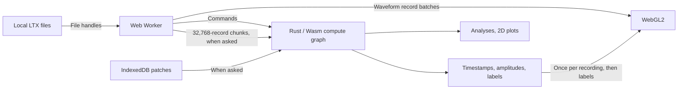

# Architecture

## Ownership

React owns UI state and display arrays, never the waveform file. A module worker owns the one Wasm instance, file references and cut sessions (each a cut source and its edit history); requests are serialised there, so history cannot be edited concurrently. Everything computed lives in Rust's compute graph (see below). The worker request protocol is typed in `src/worker/protocol.ts`, and the Wasm exports in `src/worker/wasm.ts` (a unit test checks the table against the compiled module).

The Rust crate (`core/`) parses tetrodes and cut/CLu files incrementally into builders, computes peak-to-peak amplitudes, runs every edit as a command (lasso, brush, waveform gate, merge, swap; `core/src/commands.rs`), produces undo patches and exports, processes position, band-passes `.egf` signals, computes analyses, and selects and groups the GPU-resident waveform records. RustFFT provides FFTs through the reusable `dsp` module, including WebAssembly SIMD acceleration. `.egf` files are averaged down to about 250 Hz as they're read; sci-rs (a Rust port of scipy) designs the Butterworth band-pass and applies it forwards and backwards (`sosfiltfilt`), and the Hilbert transform is scipy's on RustFFT (`core/src/lfp.rs`, tested against scipy's output). From the analytic signal come the distribution of instantaneous frequency (the position pane) and each cell's spike phase (with its spikes; a tile plot), both in the same compute graph as the tetrode's values. Nalgebra provides covariance multiplication and symmetric eigendecomposition for waveform PCA, using the same dependency version/features as prekk. JavaScript does browser I/O, scheduling and buffer transfers.

## Source layout

- `core/src/`: the Rust core: the compute graph and its handlers, commands, file builders and the simulated recordings.
- `src/worker/`: the Web Worker and its modules (position parsing, IndexedDB undo history, simulated files, Wasm bindings), the main-thread `client.ts` and the shared `protocol.ts`.
- `src/app/`: hooks used by `App` (analyses, floating copies, waveform split, keyboard shortcuts, browser history, prepared cut downloads).
- `src/shell/`: layout regions (toolbar, files, position and feature panes, start screen), pane dividers, floating windows and tool panels.
- `src/tiles/`: the cell tile wall, its gestures (drag-merge, split, swap) and the GPU waveform renderer.
- `src/plots/`: the feature view and its GPU renderer, analysis and path plots, WebGL helpers and plot geometry.
- `src/`: `main.tsx`, `App.tsx` (application state, loading and edits), preferences, types, palette and file organisation.

## Population data

For N spikes (about 1.94 GB of file at 9M spikes, which is never copied whole into JS or Wasm; it is read through Blob slices):

| Data                  | Representation                                      | At 9M spikes    |
| --------------------- | --------------------------------------------------- | --------------- |
| Timestamps            | `u32[N]`, raw acquisition ticks                     | 36 MB           |
| Amplitudes            | `u8[N*4]`, peak-to-peak per channel                 | 36 MB           |
| Labels                | `u16[N]`                                            | 18 MB           |
| Cell membership index | lazy `u32` indices grouped by label                 | 36 MB once used |
| Waveform slot order   | `u32` per GPU-resident record (at most 1M), by cell | 4 MB            |

A waveform threshold needs one channel/sample column; the first gate on a column reads the file once and caches one byte per spike (two columns per tetrode). An interactive split also caches the source cell's waveforms (up to 400,000 spikes) so further adjustments need no file reads. The preview never touches history; finishing commits one undo patch and Escape restores the labels.

## GPU rendering

**Feature view.** Every spike is drawn from the population arrays (10 bytes per spike). Amplitudes and timestamps are sent once per recording and reattached by `worker/client.ts`; edits transfer only labels, which update one buffer in place. Axes, time range and pixel ratio are uniforms; cluster points stay at one CSS pixel. Selecting a cell brings its points forward in fixed colours; it does not hide other cells. Density and drift accumulate (count, summed time) per pixel, with the same texture formats and fallbacks as waveform rendering. Density shares the waveform colour ramp through `plots/density-colours.ts`, with scaling appropriate to point footprints; drift uses mean spike time, red (start) to green (end). Cached counts survive colour-mode switches, label edits and cell focus changes; coordinates, geometry or time range changes invalidate them.

The cluster pane can instead use four global waveform PCs, fitted across all 200 signed sample values (four channels × 50 samples, excluding timestamps). `core/src/pca.rs` plans reproducible, jittered sample blocks across the recording, fits a centred covariance using nalgebra, then projects the complete file in bounded chunks. Constant input dimensions are excluded; PCs are ordered by descending variance with deterministic signs, and scores are scaled to 0–1 over the full population. Degenerate axes stay at 0.5. The default fit uses up to 5,000 spikes, configurable from 500 to 20,000. No full waveform population is retained.

PCA adds four float32 coordinates (16 bytes per spike) only when requested. `worker/pca.ts` handles its file reads and cancellation. The basis depends on the recording and fit sample size, so cuts and undo do not refit it; the UI caches one result and confirms the worker's basis before reuse. GPU buffers accept byte amplitudes or float PCs, and both CPU picking and Rust brush/lasso cuts use exactly the displayed coordinates. Region edits carry the PCA basis key to reject stale selections after a refit. Both spaces show the same six channel/component pairings in 2D.

The optional 3D cluster view (`plots/Cluster3D.tsx`) displays three of the four channels or PCs, reusing the same population buffers. G or the numbered feature button cycles the omitted feature 4 → 3 → 2 → 1; the chosen axes are shared by GPU drawing, nearest-point picking and Rust cuts. The cube's feature axes and labels are black. `plots/cluster-camera.ts` supplies the orthographic camera. Navigation is the initial tool: drag rotates, Shift-drag pans and scrolling zooms around the pointer; right-drag also rotates while cutting. L cycles navigation, paint and lasso; Escape cancels an unfinished stroke while keeping the current tool. Brush/lasso regions pass through every depth of the current projection, restricted to source cells, with the existing transactional undo history and PCA basis validation. `core/src/projection.rs` rasterises connected brush strokes into a mask bounded to 4 MiB before scanning the population. Camera changes invalidate density/drift accumulation; fixed colours use depth testing. Changing the recording or feature basis resets the camera and cancels an unfinished gesture. The 3D and omitted-feature preferences persist.

The 3D settings dropdown uses the main toolbar settings icon and shares `shell/ActionMenu.tsx` with the file menu. It offers Reset 3D view, Copy projection and Restore projection, with keyboard navigation and outside-click dismissal. Copy/restore uses a compact versioned text code, for example `waveform3d:v1:A1-A2-A3:-0.6,0.4,1,0,0`. The readable axis triple identifies the feature space and omitted feature; the remaining fields preserve full-precision camera yaw, pitch, zoom and pan. Restoring leaves the current PCA sample limit unchanged; older codes containing that field are accepted but the field is ignored. Camera state belongs to `FeaturePane` so restoring a code survives feature-space changes and PCA preparation. Copy writes directly to the clipboard using ClipboardItem; clipboard read or validation failures use an error toast. Copy and restore notifications use the shared toast and dismiss after five seconds. Space-click captures the preserved WebGL frame plus cube and labels. `shell/GrabOutline.tsx` draws the hovered grab target as a fixed portal above canvases and floating windows, independent of their stacking contexts.

**Waveforms.** Up to 1M records are resident: all spikes up to 1M, otherwise 1M evenly spaced ones (flagged once in the toolbar). Records keep the file's 216-byte layout in an `R8I` texture array that the shader reads directly; the tile wall loads them in ~4 MB layers. Each cell renders once, in per-frame budgets, into a texture of per-pixel (line count, summed spike time), cached by a hash of the cell's resident records; frames only composite those textures into tiles. Flag, density and drift colour the same counts, so switching is instant, and edits re-render only cells whose membership changed.

Waveform density matches v1's tetrode-wide scale: its original colour ramp receives `sqrt(10 × pixel count / total resident waveforms)`, using one denominator for every cell, including captures. Dividing by the resident total preserves the population fraction for sampled recordings; filtering or scrolling the wall does not rescale the palette. Fixed colours and drift do not use this normalisation.

Drift and exact counts need `EXT_color_buffer_float` and `EXT_float_blend`; without them drift is not drawn and density counts saturate. Nothing else is sampled: analyses, autocorrelograms and the position overlays use every spike.

Waveform frame geometry (shared by the shader, split marker and gestures) lives in `plots/plot-geometry.ts`.

Plot buttons, rendering options and feature-pane choices share `shell/ToggleButton.tsx`: small-radius corners, neutral pressed fill, stronger border/icon, and `aria-pressed`. Mutually exclusive choices (colour mode, tetrode, feature space and brush/lasso) use joined segments; independent plot toggles retain gaps. Trials use square stacked rows with the same neutral selected fill and horizontal rules. In copy mode, excluded trials are faded and desaturated; included trials retain normal file colours and selected-cut styling. The displayed trial keeps a stronger background. The feature-tool pairs are separated from each other and from the source/destination controls, with matching row centres even when sources wrap. The feature-space icons have full accessible names and tooltips (Amplitudes / Principal components).

`Settings.renderMode` is one of fixed/density/drift, shared by waveform and feature plots, and in drift also by rate maps and path spikes: a rate map's opacity is its rate (against the colour maximum, unstepped) and its colour each bin's mean spike time, smoothed and masked like the map, and each path spike is coloured by its own time, both red (start) to green (the recording's last spike); saved independent drift/density booleans migrate to this single choice. The independent palette button at the left of the cluster toolbar persists a fixed-colour override for those plots; turning it off resumes following the main mode. P cycles forwards and Shift+P backwards; D has no binding. Q switches amplitudes/principal components; L switches brush/lasso. App text selection is disabled except for editable fields and header content; selected header text retains native Cmd/Ctrl-C rather than invoking plot copying.

The Settings pane starts with position processing: Use both LEDs when available is checked by default and falls back to one LED and movement direction when a second LED is unavailable. The Cluster plots section contains the PCA fit sample size, followed by separate sections for spatial rate maps, spatial autocorrelation, direction, speed and temporal autocorrelation. Settings sliders show a separate value readout with units and labelled endpoints. Zero is shown as Off for boxcar smoothing, jump filtering and position smoothing, or Auto for the rate-map colour maximum. Each slider may give a `hint(value)` function; a falsy result shows no hint, and any text is shown under the slider and linked as its accessible description. Reset, copy and restore icon buttons sit at the top. Sections form an accordion with one open at a time and retain the last section. The window fits its content up to the viewport height, keeping scrolling available on small screens. Shared floating windows use a quiet border, flat header and soft shadow. `app/settings-clipboard.ts` writes a flat, versioned YAML mapping of all settings (including rendering mode and PCA fit size); restoration validates the entire mapping before changing state. Clipboard read or validation failures show an error toast without opening another input; copy/restore notifications dismiss after five seconds.

Temporal autocorrelograms default to a 1,000 ms positive-lag window and independent 5 ms bins. V1 used 500 ms with 100 bins (also 5 ms). Rust counts every distinct spike pair below the window, with a final partial bin when necessary; both are part of the temporal autocorrelogram's key. A single bin still draws a visible trace. Directional maps have independent angular bins and boxcar smoothing; changing spatial binning or smoothing does not change their values. Preferences and clipboard mappings from before `dirSmooth` preserve their previous shared radius when restored; missing temporal bin widths use the new default.

**Calibration.** `pixels_per_metre` comes from a header edit, then the file. If neither gives a positive value, the largest dimension the LEDs used (or, if they were never seen, the window) is taken to be 1 m, purely so the data can be looked at; the position pane warns about it and links to the headers panel. Edits (`HeaderEdits`, by `fileId`) are app state, so they last as long as the browser has the files and are never written to them. `shell/header-edits.ts` lists the headers that can be edited, with each one's rule and arrow-key step (Up/Down in the edit box: 5 for `pixels_per_metre`, 20 for `sync_offset_ms`); typed values are validated with `Number`, and `positionSource` parses them the same way. Valid values apply as they're typed or stepped, like the Settings sliders; Escape puts back what was there before editing began (removing the edit if there was none). Edits are inputs to the compute graph, so changed values are new keys and plots recalculate.

**Sync offset.** `sync_offset_ms` is a position header that files never have: it is editable, but not a real header in the file, shown as 0 until edited, and lasts as long as other header edits. Spike times are the reference clock; the offset moves the whole position track, so a spike at t takes the sample recorded at t − offset, and spikes outside the moved track are not placed. Being per position file, it is per trial. The path, occupancy and speed dwell don't depend on it. The toolbar's headers button shows a dot if an active file's header is edited or estimated.

Position samples use a regular clock starting at zero, defined by the header's sample rate; embedded record timestamps do not affect processing. Spike lookup is a direct sample-index calculation (after the sync offset), each valid sample contributes one sample period of dwell, and speed/jump filtering use elapsed sample counts. LED swapping uses v1-style pixel-size evidence plus a continuity improvement exceeding 1 cm for each LED, comparing against the preceding corrected positions. Raw pixel-count statistics are cached once and shared by processing variants; missing or indistinguishable spot sizes cannot trigger a swap. Combining two valid LEDs retains their midpoint. Spatial maps retain v2's binning and position-smoothing settings, while masking bins that were unvisited before rate-map smoothing. Directional plots use v1's display convention: zero points left and pi/2 points up.

`shell/FileMenu.tsx` holds the Waveform icon's keyboard-accessible dropdown, with Add folder…, Add files…, Clear files, Reset settings… and View on GitHub, above the version from `package.json`. Both pickers add to the workspace through `FileInputs.tsx`; Clear files returns directly to the start screen without a confirmation dialog. Reset settings… confirms, removes Waveform's `localStorage` keys and reloads; cut labels and edit patches in IndexedDB are kept. Closed menus leave app shortcuts available.

## Clipboard comparisons

Copy mode can include additional trials without changing the displayed recording. Each uses the same tetrode number and its remembered cut (or first cut), including saved local edits; clicking its existing cut buttons can override that choice for the clipboard. The worker's `copy_analysis` request asks the compute graph for each trial's analyses at its session's history (or its cut's, if it has none), so what is already computed isn't read again; a recording's spikes are read only if the graph lacks them. It never activates that recording or transfers its population to the UI. New selections cancel obsolete reads between chunks.

`app/copy-plots.ts` draws analysis captures at consistent sizes. `app/clipboard-layout.ts` builds a borderless HTML table for multiple trials, with fixed column widths sized to the displayed plots, narrow gutters and one subrow per chart type. Compact row spacing separates cells without large blank bands. Headings use `t# c#` (tetrode first), as do tile-popout titles, without a copy suffix. Headings and statistics remain editable text; plots remain separate images, with a subtle cross for missing cells, tetrodes or position data. Multi-trial copies omit spike counts and put peak firing rates above the spatial and directional maps, with a footnote explaining the values. The left column contains the cell heading and optional waveforms, narrowing to the heading when waveforms are hidden. Empty waveform cells preserve alignment without spacer images or font-dependent whitespace. Shared trial-name prefixes are omitted from column headers; footnotes identify the waveform source and record the full trial names and selected cuts. Only the displayed trial contributes waveforms. A single trial uses the original title-and-stats line followed by its plots in one compact row, without a table or trial footnotes.

Cmd/Ctrl-C targets the position pane when hovered; holding it for 500 ms enters path copy mode. Tile clicks select spike overlays, with other tiles faded. Live paths and copies share centred, pixel-aligned 3×3 CSS-pixel spike squares through `drawSpikeLayers`. `app/copy-paths.ts` exports a 160 px path and speed dwell per trial, each under an editable heading, with one shared coloured cell legend at the bottom. Like other copies, it asks the compute graph, so the displayed recording's values are reused. This mode never captures tile plots.

Spatial autocorrelation (SC, off by default) follows the spatial rate map in the toolbar and tiles. A shows SC alone; Shift-A toggles it alongside other plots. `core/src/spatial_ac.rs` computes local Pearson correlations at every linear displacement from three forward and four inverse transforms through `dsp::Fft2`/RustFFT. Nonfinite bins are masked pairwise; overlaps below the configurable minimum (20 bins by default), and zero-variance overlaps, remain invalid. SC uses MATLAB jet(64) on a fixed −1 to +1 scale. It is calculated only when requested.

Simulated T5–8 have 2–5 grid cells mixed with place/directional/untuned cells; their place cells have broader fields (sigma 16–28 cm) and background activity of 20–40% of the field amplitude. T7 still has two sorted cells and T8 remains uncut. Grid membership, module exponents and cell phases are stable across trials. All modules share each trial's orientation and base spacing (about 36 cm), with spacing multiplied by 1.4 per tetrode from T5 onward; trials vary orientation and base spacing slightly.

## Derived data: the compute graph

Everything computed is a lazy compute graph in Rust (`core/src/compute.rs`): a recording's spikes (`Population`), its labels at each point of its edit history, what is derived from those (counts, each cell's spikes and membership hash, the waveform order), PCA, positions and analyses. Each value is computed by a handler in `core/src/compute_handlers.rs`: a plain function of the inputs that gets what it needs by calling other handlers (the rate map calls spike samples and spatial time-in-bin; the spatial autocorrelogram calls the rate map). Every call goes through `Request::call`, which memoises: it looks the value up by key and runs the handler only when it isn't there. The memo (`core/src/cache.rs`) is an implementation detail, bounded per node and by a memory budget for large values (least recently used out); without it the handlers would still be correct, just slower, and they never see keys or the memo. A value may carry by-products for other handlers to take from it (the rate map's peak).

Values last the session. The graph's dependency tree mirrors the Settings sections: leaves are inputs (recording, cut source, edit history, position file, `.egf` file, `pixels_per_metre` and sync edits, a cell's spike set, each setting) and nodes are what handlers compute. A value's key covers every input beneath its node, so a new trial, file, edit or setting is a new key and nothing is invalidated by hand. A handler can narrow its key only by explicitly ignoring inputs it doesn't depend on (rate-map colours; the sync offset for the path and time-in-bin maps), and sets how many of its values to keep (least recently used out).

JavaScript writes the current inputs and asks for a handler by name (`compute_request`). The answer is a key digest and a table of named buffers, or what is missing for JavaScript to supply, which `src/worker/compute.ts` does before retrying: a recording's spikes or cut (streamed into Rust builders), a position or `.egf` file, a patch (from IndexedDB, by the id Rust names), a PCA fit, or a scan of the tetrode file (for a split's waveforms or sample column). A cell's spike set is its membership (spike count plus a 64-bit hash of its spike indices), so edits recompute only cells whose spikes changed and swapped cell numbers keep their analyses. Values made from kept spike times and the position, such as a rate map at a new bin width or sync offset, need nothing read again.

The page keeps only what is on screen, and asks only for the parts of the plots that are on (the stats line shows only their peaks). Whenever an input might have changed it asks again; unchanged values aren't recomputed. Each part carries its key, and `reuseParts` keeps the held arrays of parts whose keys are unchanged, so plots, which redraw on their own part's arrays, aren't repainted. Answers are fresh copies, so their buffers are transferred from the worker. Tiles also check the membership the worker analysed, so a result is never shown for a cell whose spikes have since changed.

## Timeline labels

The toolbar's timeline button opens the Timeline labels window, which gives every moment of a trial a label and chooses what plots show. Labels are whole numbers from 0 to 99, each always drawn in the same colour of the cell palette, and are chosen with a small picker (its colour, one or two digits, steps up and down or the arrow keys). Each method lists one row per label, the picker first:

- *Equal sections*: a count (1 to 100), and a row per section with its label and the times it spans; four could be 0-1-0-1, 0-1-1-1 or 0-1-2-3, and neighbouring sections with one label are one segment.
- *Custom times*: rows added one by one, each a label and the time it holds from, the first fixed at 0 s. Times stay in order, as each box applies only values between its neighbours' (typed as seconds or m:ss; leaving the box puts back the last valid value), and times after the trial's end are flagged.
- *Log file*: the first, by name, of the trial's files whose name matches a glob (`*.ttl` by default; `*`, `?`, `[abc]`, `[!abc]` and `{a,b}`, ignoring case), among the files named for the trial that the organiser doesn't otherwise use and keeps handles of (`Trial.auxFiles`); the window shows which file that is, and how many match when several do. Lines between `data_start` and `data_end` markers are read when the log has them, otherwise every line. A first row gives the label before any match; then each line is tried against the rules in order and the first that matches changes the label, from the time it captures, until the next change. A rule is a regular expression (regex-lite's syntax; the window has a cheat sheet and links to its reference) matching anywhere in a line, the time in the group named `time` or else the first, in seconds, milliseconds, microseconds or ticks at a given rate. Each rule shows how many lines it matched; an invalid rule is reported in the window rather than as an error.

Defaults are numeric throughout: sections 0 and 1, and log rules `^ttl_4 (\S+) 1$` giving 1 and `^ttl_4 (\S+) 0$` giving 0 as TTL 4 goes on and off. The window shows the labels across the trial and a table of each label's time, share of the trial and segment count, with a Total row for the whole trial. Ticking rows chooses what plots show: Total for the whole trial, and each ticked label alone, so a label can be compared with the total, with other labels, or shown by itself. Total alone, the default, is no labelling; the last ticked row can't be unticked. No plot uses this yet. The toolbar's timeline button shows a dot when anything but Total alone is ticked. The configuration is a preference, and the window's copy and restore buttons write and read a one-line code for lab notes, `waveform-labels:v1:` followed by compact JSON (the log glob as `file`, sections as their labels, custom times as `[seconds, label]`, rules as `[pattern, label]` with unit and rate appended only when not the defaults, and the ticked rows only when not Total alone). Restoring finds the code anywhere in pasted text; the version is for migrating older codes.

In the compute graph (`core/src/time_labels.rs`, handlers in `compute_handlers.rs`) the configuration is three text leaves: the log file's identity, the rules (one canonical text, see `Rules::parse`) and the label a mask covers. `LogRaw` is the log as read (JavaScript supplies it), `LogChanges` its change points under the rules, `TimeLabels` the trial's segments (keyed on the recording, whose header gives the trial's duration) and `TimeMask` the merged intervals one label covers, or with no label the whole trial. Plots will ask for one mask per ticked row (`timeSelections`, `timeMaskSource`); Total has no rules, log or label, so what is made with it never depends on the configuration.

Other caches:

- **GPU:** four feature-view buffer sets; waveform tile textures up to 192 MB.

## Cut histories

Each (file, cut) has its own undo/redo history. The first edit of an imported cut, or of an unsorted recording, creates a separate local (blue) cut; files on disk are never modified. Edits are commands: each makes new labels from the labels at the session's history and keeps them, with their patch (sparse changed indices, or dense labels when smaller), under the history extended by the patch's id. The worker stores the patch in IndexedDB before adding the id to the history, so a failed store changes nothing. Labels at a history are those kept for it, or the nearest kept earlier labels (or the cut's) with the patches since applied, so undo and redo are asking for a shorter or longer history, usually still kept. A split preview is a tentative patch, shown but only added when the split finishes. Switching cuts needs nothing saved: each session is its history. The history pane places icon-only undo/redo controls at the top right. History lives for the browser tab; exporting a `.cut` is the durable result.

Only explicit trial/tetrode/cut choices add browser history entries, so Back/Forward moves between recordings (cancelling an open split first).

## Simulated recordings

The start screen's demo generates five trials of eight tetrodes (about 50k spikes over 20 minutes each) in Rust, on demand by record range, so no large fake files are held. Cells are place, head-direction or untuned, with Poisson spiking and theta modulation; one or two cells per tetrode drift in amplitude. Tetrode 7 is partly cut and tetrode 8 has no cut. Trials a and c have a `.ttl` log: a light on TTL 4 switched on and off in blocks of about two minutes, from about a minute in, and brief reward pulses on TTL 2 every 10 to 40 s. Each trial has two `.egf` files carrying the same theta rhythm that modulates the spikes, larger when the animal runs faster, with delta, theta-nested gamma and noise. `?demo=quick` is a smaller fixed-seed version for tests; `?demo=stress` targets 1M spikes and 100 cells. The 9M version requires `?demo=stress-9m`; setting `WAVEFORM_STRESS_9M=1` runs the browser stress workflow at 9M instead of the default 1M.

## Static hosting

Vite emits relative paths and a hashed Wasm asset, so the app runs from GitHub Pages under `/waveform/` with no server, SharedArrayBuffer or cross-origin isolation headers.

## Browser coverage

The regular suite has 36 cases, with two real-data cases enabled only when their external fixtures are available. Related actions share a loaded recording: 3D navigation and projection restore, PCA cuts and refitting, pane gestures and cell clipboard, and position copy and spatial autocorrelation. This avoids repeating demo generation and GPU setup for cosmetic checks. Full-population edit/undo/export, missing trial data, folder identity, GPU format fallbacks, persisted settings, and production-subpath loading remain browser workflows.

Numerical binning, palette rules and small drawing edge cases belong in Rust or Vitest. Position-cache checks observe the base canvas actually drawn rather than requiring two PNGs to differ. Routine successful runs do not save screenshots; failures retain a screenshot and DOM/action trace, without continuous GPU screenshots.
