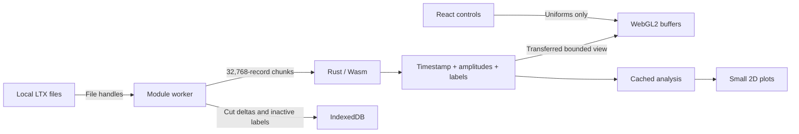

# Data flow, caches and bounded work

## Ownership

React owns control state and bounded display arrays, never the full waveform file. A worker owns opaque Rust engine pointers, population arrays, file references, cut sessions and analysis caches. One Wasm instance owns all engine allocations in the worker. Eviction frees inactive engines for allocator reuse; Wasm linear memory retains its high-water allocation until the worker closes. The 384 MiB target bounds retained engine data, not the whole browser process.

The Rust crate is dependency-free. It parses cuts/CLu incrementally, decodes signed samples, computes peak-to-peak amplitude, retains timestamps/labels, samples waveforms, prepares display buffers, rasterises waveform density, processes position, computes analyses, generates/applies undo patches, formats exports and applies polygon, raster-brush, waveform-gate, merge, swap and renumber operations. JavaScript performs browser file/storage I/O, asynchronous scheduling and bulk buffer transfers. The worker validates format/count/range constraints before invoking the raw ABI. Allocation helpers accept byte buffers; addresses remain stable across Wasm memory growth, and JS typed-array views are reconstructed after operations that may allocate.

Position processing, histograms, occupancy and rate maps run in the same worker. UI updates cannot run large file or analysis loops on the React thread. Responses carry request IDs; React generation checks discard stale display results. New load requests cancel superseded chunk scans at the next asynchronous boundary. Mutations are serialised so files, labels and history cannot be edited concurrently.

## Population representation

For N spikes:

| Data                    | Representation                                                                | 9 million spikes            |
| ----------------------- | ----------------------------------------------------------------------------- | --------------------------- |
| Timestamps              | `u32[N]`, raw acquisition ticks                                               | 36 MB                       |
| Peak-to-peak amplitudes | `u8[N*4]`, signed-wave max−min                                                | 36 MB                       |
| Active cell labels      | `u16[N]`                                                                      | 18 MB                       |
| Cell membership index   | Lazy cached `u32` indices, grouped by label for repeated per-cell analysis    | 36 MB after first analysis  |
| Waveform input          | 32,768 × 216 byte scratch chunk                                               | 7.08 MB                     |
| Waveform samples        | Up to 128 sampled records per initial cell, replenished for newly split cells | About 2.56 MB for 100 cells |

The input file itself is about 1.94 GB. It is held as a browser File reference and read with Blob slices. It is not copied into JS or Wasm as one buffer. File timestamps, amplitudes and record order are retained exactly. Raw ADC amplitudes are displayed without claiming calibrated microvolts.

A waveform threshold needs one channel/sample column that the compact amplitude representation cannot reconstruct. The first gate on a column reads the file in chunks and caches one signed byte per spike; two columns are retained per tetrode. For interactive split mode, the first required scan also caches all source-cell waveforms when the source has at most 400,000 spikes (81.6 MB including indices). Further channel/sample/threshold adjustments then use those cached records; larger groups use the two-column cache. Source membership and original labels stay fixed during preview. A left click persists one final undo patch; Escape restores the original labels. Preview caches are released after finish/cancel.

## Display and GPU

A default 250,000-point feature view transfers about 3.5 MB: 1 MB amplitudes, 1 MB normalised times, 0.5 MB labels, 1 MB indices. No millions-of-object JS model is built. Points are evenly spaced across the original index range. Counts and editing always use every spike; the sample is only a visual LOD.

One WebGL2 context draws six projections from one VAO/buffer set. Axis selection, time colouring, visible time range, point size, alpha and selected-cell isolation are uniforms. These settings neither reread files nor rebuild population features. Buffers are reused across renders; only changed labels are uploaded after edits. Up to four view buffer sets are cached, with least-recently-used eviction.

The tile wall sizes cells from the enabled plot widths and wraps them into columns. It virtualises grid rows and shares one WebGL2 waveform context; a single atlas maps visible cell densities onto their grid positions. Hover counts/rates are an HTML overlay, hidden during tile dragging. A drag captures one bounded, headerless PNG and masks its original slot with a placeholder. Snapping positions the PNG over its target; a CSS opacity cycle compares the plots without additional GPU contexts, rasterisation or population processing. The position canvas draws separately coloured source/target spike layers from cached worker analyses. Only releasing on an actual snapped target issues a merge edit; a cancelled drop returns the PNG with a short horizontal settling animation. Flag waveforms use signed-byte textures and instanced line strips. Density mode uses Rust-generated 512 × 128 `u16` count images per cell, cached until labels/samples change; WebGL2 uploads an atlas of visible rows and applies the palette. Numeric rate settings do not rerasterise waveform counts. Floating comparisons store titleless PNG snapshots and small frozen stats arrays; their title is shown in the window header and stats are drawn as an HTML overlay only on hover. Space-click closes both comparison and tool windows. Copies retain no population arrays or additional live GPU contexts. WebGL context restoration recreates projection resources.

Waveform density is computed from the bounded waveform reservoir, rather than every waveform in the input file. Waveform and feature sampling, plus large autocorrelation sampling, are visible in the UI and documented in the feature inventory.

Data pixels retain a common scale in x/y. Rate-map bins are square; trajectory coordinates use physical arena dimensions; feature projections use square viewports and the same transform for lasso picking. Waveforms use a fixed four-channel grid in both density and flag modes; narrow panes scroll. The direction radius is circular and histogram frames keep their proportions. PNG copies preserve the captured pixel aspect.

## Cut histories

Each `(file identity, cut identity)` has its own undo/redo metadata. Before an edit, one temporary label copy is taken. A sparse patch stores changed indices and before/after labels (8 bytes per changed spike); if that exceeds two compact label snapshots, the dense representation is used instead. The immutable patch is committed to IndexedDB before an edit is accepted. Storage failure restores the previous labels and counts.

Undo/redo reads one patch and applies it to the labels. It does not re-decode spikes. Redo branches are cleared on a new edit. Switching cuts writes the outgoing labels to IndexedDB and restores the incoming labels. There is no fixed history depth, but browser storage quota remains a practical bound. Inactive full labels are not kept in the worker's JS heap.

Workspace/session metadata is intentionally tab-local. IndexedDB holds patch payloads and inactive labels, but reloading does not reconstruct open File objects or the metadata stack. Export remains the durable interchange mechanism. Original files on disk are immutable to the app.

## Cache limits and invalidation

- Population cache: approximately 384 MiB target, evicting inactive tetrodes first. This is a retained-cache target, not a hard bound on browser/GPU/temporary memory. Wasm allocator high-water marks, edits, clones and GC can briefly increase memory.
- Positions: four processed variants keyed by file and LED/jump/smoothing settings.
- Analysis: up to 100 results keyed by cut identity, revision, cell, position variant and numeric bin/smoothing/window settings. An edit clears derived analysis; unchanged raw tetrode features and GPU geometry are retained.
- GPU: four bounded point views; render-only controls reuse buffers.
- Cell membership: one lazy index per engine, rebuilt after label changes and reused across cell analyses.
- Density: one count image per requested cell; visible-row texture transfers reuse cached counts.
- Waveform gates: two compact sample columns per cached tetrode.

Rate-map colour ceilings only recolour an existing map. Position options reprocess position, not tetrode waveforms. Numeric map/window settings invalidate only their derived analysis. The worker's current implementation computes a selected-cell analysis bundle together; splitting that bundle into independent caches would further reduce work when changing only one analysis setting.

## Static hosting

Vite emits relative asset paths and a content-hashed Wasm asset. Main-thread initialisation resolves the imported Wasm URL against the document and passes it to the worker, so JavaScript and Wasm stay version-matched under `/waveform/`. Cargo also copies the module to `public/wasm` for native Node verification/benchmarks before Vite builds. No thread-shared Wasm memory, SharedArrayBuffer, custom server, authentication service or cross-origin isolation header is required.
