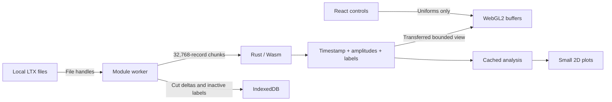

# Data flow, caches and bounded work

## Ownership

React owns control state and bounded display arrays, never the full waveform file. A worker owns opaque Rust engine pointers, population arrays, file references, cut sessions and analysis caches. One Wasm instance owns all engine allocations in the worker. Eviction frees inactive engines for allocator reuse; Wasm linear memory retains its high-water allocation until the worker closes. The 384 MiB target bounds retained engine data, not the whole browser process.

The Rust crate is dependency-free. It parses cuts/CLu incrementally, decodes signed samples, computes peak-to-peak amplitude, retains timestamps/labels, selects resident waveform records and groups them by cell, prepares display buffers, processes position, computes analyses, generates/applies undo patches, formats exports and applies polygon, raster-brush, waveform-gate, merge, swap and renumber operations. JavaScript performs browser file/storage I/O, asynchronous scheduling and bulk buffer transfers. The worker validates format/count/range constraints before invoking the raw ABI. Allocation helpers accept byte buffers; addresses remain stable across Wasm memory growth, and JS typed-array views are reconstructed after operations that may allocate.

Position processing, histograms, occupancy and rate maps run in the same worker. UI updates cannot run large file or analysis loops on the React thread. Responses carry request IDs; React generation checks discard stale display results. New load requests cancel superseded chunk scans at the next asynchronous boundary. Mutations are serialised so files, labels and history cannot be edited concurrently.

## Population representation

For N spikes:

| Data                    | Representation                                                                | 9 million spikes           |
| ----------------------- | ----------------------------------------------------------------------------- | -------------------------- |
| Timestamps              | `u32[N]`, raw acquisition ticks                                               | 36 MB                      |
| Peak-to-peak amplitudes | `u8[N*4]`, signed-wave max−min                                                | 36 MB                      |
| Active cell labels      | `u16[N]`                                                                      | 18 MB                      |
| Cell membership index   | Lazy cached `u32` indices, grouped by label for repeated per-cell analysis    | 36 MB after first analysis |
| Waveform input          | 32,768 × 216 byte scratch chunk                                               | 7.08 MB                    |
| Waveform slot order     | `u32` per resident record (at most 1M), grouped by cell, plus per-cell hashes | 4 MB                       |

The input file itself is about 1.94 GB. It is held as a browser File reference and read with Blob slices. It is not copied into JS or Wasm as one buffer. File timestamps, amplitudes and record order are retained exactly. Raw ADC amplitudes are displayed without claiming calibrated microvolts.

A waveform threshold needs one channel/sample column that the compact amplitude representation cannot reconstruct. The first gate on a column reads the file in chunks and caches one signed byte per spike; two columns are retained per tetrode. For interactive split mode, the first required scan also caches all source-cell waveforms when the source has at most 400,000 spikes (81.6 MB including indices). Further channel/sample/threshold adjustments then use those cached records; larger groups use the two-column cache. Source membership and original labels stay fixed during preview. A left click persists one final undo patch; Escape restores the original labels. Preview caches are released after finish/cancel.

## Display and GPU

A default 250,000-point feature view transfers about 3.5 MB: 1 MB amplitudes, 1 MB normalised times, 0.5 MB labels, 1 MB indices. No millions-of-object JS model is built. Points are evenly spaced across the original index range. Counts and editing always use every spike; the sample is only a visual LOD.

One WebGL2 context draws six projections from one VAO/buffer set. Axis selection, time colouring, visible time range, point size and selected-cell isolation are uniforms. These settings neither reread files nor rebuild population features. Buffers are reused across renders; only changed labels are uploaded after edits. Up to four view buffer sets are cached, with least-recently-used eviction.

The tile wall sizes cells from the enabled plot widths and wraps them into columns. It virtualises grid rows and shares one WebGL2 waveform context; a single atlas maps visible cell densities onto their grid positions. The original 256-entry group palette is shared by CPU/GPU drawing; the original density palette uses sampled population sizes for normalisation. Hover spike counts and peak rates use the original bottom-right stats layout, hidden during tile dragging. A pointer-transparent page-layer halo lets the yellow hover glow extend over the toolbar without covering the shared canvas. A drag captures one bounded, headerless PNG and masks its original slot with a placeholder. Snapping positions the PNG over its target; a CSS opacity cycle compares the plots without additional GPU contexts, rasterisation or population processing. The position canvas draws separately coloured source/target spike layers from cached worker analyses. Only releasing on an actual snapped target issues a merge edit; a cancelled drop returns the PNG with a short horizontal settling animation. Waveforms are described below. Numeric rate settings do not rerender waveform counts. Floating comparisons store titleless PNG snapshots and small frozen stats arrays; their title is shown in the window header and stats are drawn as an HTML overlay only on hover. Space-click closes both comparison and tool windows. Browser command modifiers cannot trigger the plain-letter plot shortcuts before a reload/close warning. Copies retain no population arrays or additional live GPU contexts. WebGL context restoration recreates projection resources.

### Waveforms

Up to 1,000,000 waveform records are GPU-resident: every spike when a tetrode has at most 1M, otherwise 1M evenly spaced records (slot `s` is record `⌊s·N/M⌋`). Records stay in the file's raw 216-byte layout in an `R8I` texture array (9 records per 1,944-byte row, 2,048 rows per layer, within WebGL2's guaranteed limits); the vertex shader reads samples directly, so no CPU transposition is needed. Records are not retained in Wasm. The tile wall loads them one layer (18,432 records, about 4 MB) per `wave_batch` request: unsampled layers are a single Blob slice transferred untouched, while sampled layers stream through Rust, which copies only resident records with one fixed-size copy each. The Wasm build enables SIMD.

After each label change Rust counting-sorts resident slots by cell and computes an order-independent 64-bit hash of each cell's slot set. The tile wall uploads that order (4 MB at 1M) and renders each cell once, as additive per-pixel line counts, into an offscreen texture cached by its hash; frames only composite cached textures into tile viewports. Rendering is budgeted to 131,072 spikes per animation frame, so large cells fill in progressively. Merges, swaps and split previews rerender only cells whose membership changed; renumbered cells reuse their image because colour is applied at composite time. Flag mode colours any non-zero count; density mode applies the original palette, normalised by the cell's resident count, so switching mode does not rerender. Counts are exact with `EXT_float_blend` (R32F), saturate at 2,048 with half floats, or at 255 without float render targets. The cache is bounded to 192 MB and is cleared on tile-size or recording changes; context restoration reloads the records.

Sampled waveforms (tetrodes over 1M spikes), sampled feature views and sampled large autocorrelograms show “WARNING: using sampled rendering” on hover.

Data pixels retain a common scale in x/y. Rate-map bins are square; trajectory coordinates use physical arena dimensions; feature projections use square viewports and the same transform for lasso picking. Waveforms use a fixed four-channel grid in both density and flag modes; narrow panes scroll. The direction radius is circular and histogram frames keep their proportions. PNG copies preserve the captured pixel aspect. Comparison windows have no resize handle and drag from any point in their content; tool windows keep title-bar dragging and resizing. The grid centres in available pane space; oversized grids remain scrollable from their first row. Paint is the default tool and group chips wrap. Feature slots are 128 px squares separated by 4 px gaps, using shared layout geometry for WebGL viewports, pointer picking and PNG copies; each plot has all four borders. They have only top-left Y / bottom-right X labels (A1–A4); captures bake those labels into their PNG. The position summary stays visible over a faint white backing with a small left margin. It uses speed dwell occupancy with a red vertical line beside the bars and a maximum-speed label; there is no horizontal axis. Recording statistics occupy two small lines at the toolbar’s right edge, replacing the footer. Rendering controls live in Settings; the feature-pane checkboxes and numeric waveform-split form have been removed. The path fills its pane, fits physical x/y uniformly and starts at the top. Duration uses whole minutes and seconds. Clock times prefer the recorded trial_time header, avoiding viewer-timezone changes.

## Cut histories

Each `(file identity, cut identity)` has its own undo/redo metadata in the existing worker, not a separate thread or Wasm instance. The first actual edit to an imported cut (or unsorted recording) creates a new blue local cut and leaves the imported original intact. Further edits update that local cut. A cut duplicate copies history references as well as labels, including the redo stack. Before an edit, one temporary label copy is taken. A sparse patch stores changed indices and before/after labels (8 bytes per changed spike); if that exceeds two compact label snapshots, the dense representation is used instead. The immutable patch is committed to IndexedDB before an edit is accepted. Storage failure restores the previous labels and counts.

Undo/redo reads one patch and applies it to the labels. It does not re-decode spikes. Redo branches are cleared on a new edit. Switching cuts writes the outgoing labels to IndexedDB and restores the incoming labels. There is no fixed history depth, but browser storage quota remains a practical bound. Inactive full labels are not kept in the worker's JS heap.

Workspace/session metadata is intentionally tab-local. IndexedDB holds patch payloads and inactive labels, but reloading does not reconstruct open File objects or the metadata stack. Export remains the durable interchange mechanism. Original files on disk are immutable to the app.

The organiser displays tetrodes and their cuts inline at both collapsed and expanded sizes. It remembers the last cut per trial/tetrode. A four-entry export Blob cache prepares local cuts in the worker, including inactive cuts via a label-only Rust engine; this does not switch the active recording or mutate its history. Native dragging supplies a File and Chromium DownloadURL. Cold exports must finish preparation before the drag begins.

Rendering/analysis settings, plot visibility, isolation, divider positions and named tool-window geometry persist in localStorage. Only settings are restored after reload. Layout restoration clamps dimensions and positions to the current viewport.

## Cache limits and invalidation

- Population cache: approximately 384 MiB target, evicting inactive tetrodes first. This is a retained-cache target, not a hard bound on browser/GPU/temporary memory. Wasm allocator high-water marks, edits, clones and GC can briefly increase memory.
- Positions: four processed variants keyed by file and LED/jump/smoothing settings.
- Analysis: up to 100 results keyed by cut identity, revision, cell, position variant and numeric bin/smoothing/window settings. An edit clears derived analysis; unchanged raw tetrode features and GPU geometry are retained.
- GPU: four bounded point views; render-only controls reuse buffers.
- Cell membership: one lazy index per engine, rebuilt after label changes and reused across cell analyses.
- Waveform tiles: one count texture per cell membership set; mode, colour and scroll changes only recomposite.
- Waveform gates: two compact sample columns per cached tetrode.

Rate-map colour ceilings only recolour an existing map. Position options reprocess position, not tetrode waveforms. Numeric map/window settings invalidate only their derived analysis. The worker's current implementation computes a selected-cell analysis bundle together; splitting that bundle into independent caches would further reduce work when changing only one analysis setting.

## Static hosting

Vite emits relative asset paths and a content-hashed Wasm asset. Main-thread initialisation resolves the imported Wasm URL against the document and passes it to the worker, so JavaScript and Wasm stay version-matched under `/waveform/`. Cargo also copies the module to `public/wasm` for native Node verification/benchmarks before Vite builds. No thread-shared Wasm memory, SharedArrayBuffer, custom server, authentication service or cross-origin isolation header is required.

## Generated recordings

The landing-page file stack is a click-only button. The default generates five trials and eight tetrodes per trial; recordings have roughly 50,000 spikes over 20 minutes, with 24, 36 and 48 cells plus noise across tetrodes. A fresh seed determines cell templates, waveform variation, simple uniform sample noise and spatial firing preferences. Tetrodes in a trial share one generated position trajectory and acquisition clock. At 50 Hz, the simulator perturbs angular velocity and target speed, includes brief pauses, and uses look-ahead wall avoidance and slowing within a 1 × 1 m arena. A 10 × 10 occupancy grid biases targets towards unvisited and lightly visited squares while angular inertia preserves smooth turns. Trajectories are shared as immutable data across tetrodes in the existing Wasm instance.

Rust generates position records, cut labels and random-access tetrode record ranges. The worker returns normal set/pos/cut Files and small tetrode markers; before decoding, a marker resolves to a worker-only File adapter whose size and slice/stream methods expose the full generated recording. Only requested chunks are materialised. The existing decoder, waveform batches, gating reads, caches and edit/export paths operate on the full population. This avoids retaining several GB of artificial waveform Blobs and adds no worker or Wasm instance. Generated-demo timings include synthesis, not real disk throughput.

`?demo=quick` uses the same generator at a smaller scale with a fixed seed for routine interaction tests. `?demo=stress` selects the 9M-spike/100-cell workload. CI separately exercises this stress demo and the ordinary 50k/20-minute demo, including exact merge/undo/export integrity. The generated cut files remain ordinary exportable files.

## Recording navigation

Only explicit trial/tetrode/cut choices push browser history entries, using history.state without changing the URL. Re-selecting the current recording adds no entry. Edits that create a local cut replace the current entry’s cut identity; undo/redo, cell selection, rendering controls and window/pane changes add none. Back/Forward restores the selected recording and its existing cut history, cancelling an unfinished split preview first. A workspace identity prevents stale entries from a previous tab workspace from selecting unrelated data. Readiness requires both a completed load and a view whose session matches the requested selection, avoiding stale results during fast navigation.
